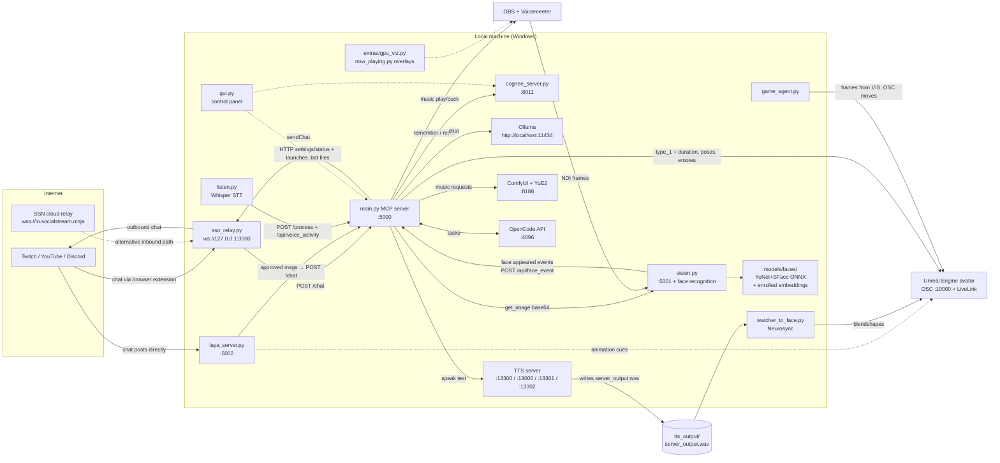

# Architecture — Processes, Ports, and Who Talks to Whom

**Audience:** AI coding assistants + maintainer. **Answers:** "what process is that, on what
port, in which conda env, and how do the pieces connect?"

Last verified: 2026-10-12. Ports/URLs are defaults from `config_example.py` — live values come
from `config.py` (single source of truth, rewritten in place by `save_config()`, main.py:460).

## 1. System diagram

**Two-machine option:** if `TTS_COPY_TO` (network share) is set, the TTS WAV and
`current_pose.txt` are copied to a second machine which runs `watcher_to_face` and drives the
Unreal avatar there (main.py:2540-2547).

## 2. Process / service map

| Process | Start script (conda env) | Port / URL | Role |
|---|---|---|---|
| **main.py** (MCP server) | `start_mcp.bat` (`mcp_env_2`) | `:5000` (bind `0.0.0.0` via `SERVER_BIND_HOST`) | The hub: message pipeline, all `/api/*` endpoints, OSC sender, settings persistence, face-event greetings. Auto-started by gui.py |
| **gui.py** | `start_gui.bat` (`mcp_env_2`) | — | Control panel (19 tabs). Launches every service as detached consoles; edits settings via `POST /api/settings` (main.py:1905); polls `GET /api/status` every 5s; face enrollment UI proxies through main.py |
| **cognee/cognee_server.py** | `start_cognee.bat` (`cognee`) | `:8011` | Long-term memory graph: `POST /remember`, `POST /recall`, `GET /health`, `GET/POST /settings` (rewrites its own `.env`) |
| **clients/laya_server.py** | `start_laya.bat` (`laya`) | `:5002` | Optional pre-filter between SSN and main.py. Local Laya model (in `models/laya/`) classifies animation cues (→ OSC direct) and gates which messages deserve an LLM reply |
| **ssn_relay.py** | `start_ssn_relay.bat` (`mcp_env_2`) | `ws://127.0.0.1:3000` | Local replacement for the SSN cloud relay. Implements the SSN WebSocket room protocol (`{"join", "out", "in"}`, `{"action": "sendChat"}`) |
| **clients/listen.py** | `start_listen.bat` (`mcp_env_2`) | — | Microphone → faster-whisper → `POST /process`; VAD pings `POST /api/voice_activity` |
| **vision.py** | `start_vision.bat` (`mcp_env_2`) | `:5001` | Camera/NDI frames + **face recognition** (YuNet+SFace). Endpoints: `GET /get_image` (base64 JPEG for the multimodal LLM), `GET /scan` (local VLM), `/ndi/sources` (list NDI streams on the network — powers the GUI's "Scan NDI" dropdown), `/faces/current`, `/faces/scan`, `/faces/list`, `/faces/enroll`, `/faces/refresh`, `DELETE /faces/<name>`. NDI source default "OBS Mixxx" — recognition watches the stream output. Pushes appearance events to main.py |
| **TTS — StyleTTS2** | `start_styletts2.bat` (`styletts2`) | `:13300` | Default engine (`TTS_ENGINE = "styletts2"`). Writes the WAV. Digits in text cause 500s — numbers must be words |
| **TTS — VibeVoice** | `start_vibevoice.bat` (`vibevoice`) | `:13000` | Alternative engine (`postapp.py`) |
| **TTS — Pocket TTS** | `start_pockettts.bat` (`mcp_env_2` or `pocket-tts`) | `:13301` | Alternative engine; own `settings.ini` (device/speed) |
| **TTS — Qwen3-TTS** | `start_qwen_tts.bat` (`qwen3-tts_312`) | `:13302` | Alternative engine |
| **Ollama** | external install | `http://localhost:11434` | LLM inference: main chat model, vision (multimodal), browser-driving model, Twitch song-request parsing (`llm.chat_sync`), idle monologues, face greetings |
| **ComfyUI + YuE2** | external / GUI Music Gen tab | `127.0.0.1:8188` | AI song generation. Workflow JSON `clients/comfyui_yue/yue2_full.json`, prompt injected into every node with a `style` input, seeds randomized |
| **OpenCode API** | external | `:4096` | AI coding agent for "oc ..." commands (enabled via `OPENCODE_ENABLED`) |
| **Neurosync: merged_watcher_to_face.py** | `start_merged_watcher_to_face.bat` (`mcp_env_2`) | — (uses Local API internally) | Watches the TTS WAV → audio-to-blendshape transformer → LiveLink → Unreal. **Owns talk animation + ducking timing.** GUI's "Start Neurosync" launches this |
| **Neurosync: neurosync_local_api.py** | `start_neurosync_localapi.bat` | — | Standalone blendshape API (merged script embeds it) |
| **game_agent.py** | `start_game_agent.bat` (`mcp_env_2`) | — | Autonomous gameplay experiment: frames from vision → OSC move/turn commands to Unreal. Independent of the chat pipeline |
| **extras**: gpu_viz.py / now_playing.py / token_usage.py | `start_GPU_Viz.bat` etc. (`mcp_env_2`) | — | OBS overlays: hardware graphs, now-playing (reads `now_playing_state.txt`), token usage. Also spawnable inside the GUI Extras tab |
| **Unreal Engine** | external | OSC `:10000` (`OSC_IP`/`OSC_PORT`), LiveLink | The avatar. Receives animation commands (strings + bool), talk notifications (address + float duration), idle-state values |

## 3. Shared state files

| File | Written by | Read by | Content |
|---|---|---|---|
| `config.py` | `save_config()` (main.py:460) via `POST /api/settings` | **every process** | All settings — the cross-process database |
| `tts_output/server_output.wav` | active TTS server (`TTS_OUTPUT_PATH`) | AudioPlayer, watcher_to_face, optional network-share copy | The current/latest utterance — single overwritten file |
| `current_pose.txt` | `_persist_pose()` (main.py:2527) | watcher process (local or 2nd machine) | Current avatar pose to restore after speech |
| `known_speakers.json` | main.py:444 | main.py:432 | Seen chatnames (nickname resolution) |
| `background_state.json` | `music.save_background_state()` (clients/music_client.py:755, shutdown main.py:2826) | `music.resume_background_from_state()` (startup main.py:2791) | Background song + position, survives restarts |
| `now_playing_state.txt` | MusicClient (clients/music_client.py:455) | `extras/now_playing.py` overlay | Current song for OBS |
| `token_usage_state.json` | LLMClient (clients/llm_client.py:29) | LLMClient; `extras/token_usage.py` overlay | Cumulative LLM token usage |
| `models/faces/enrolled/` | vision.py `FaceRecognizer` (enroll endpoint / photos folder) | vision.py scan loop | Per-person SFace embeddings (`<name>.json`) + thumbnails (`<name>.jpg`). Gitignored with the rest of `models/` — biometric data never enters the repo |
| `models/faces/photos/` | you (drop `<name>.jpg`) | vision.py `refresh_from_photos` | Enrollment photo drop zone |
| `clients/listen.ini` | — | **nobody** (vestigial) | Superseded by config.py |
| `music/twitch_restricted_artists.json` | maintainer | twitch_music_checker | Twitch DJ Program restricted artists |

## 4. Startup order

1. **gui.py** starts (optionally auto-launches main.py, gui.py:91).
2. From GUI tabs, satellites start in any order; each is a detached console running a
   `start_scripts/*.bat` in its own conda env. Reasonable order: Cognee → MCP → a TTS server →
   listener/vision/Laya as wanted (README.md:99-113).
3. **main.py `startup()` hook** (main.py:2770-2820), in order: capture event loop → check LLM,
   SSN, Cognee, music → **resume background music from state** → check TTS + start AudioPlayer
   (if `AUDIO_PLAYER_ENABLED`) → check OpenCode/vision/browser (if enabled) → start Twitch
   EventSub (if enabled) → start idle monitor loop (`start_background_tasks`,
   main.py:2757-2766).
4. **vision.py** startup (own process): camera/NDI stream first, then — if
   `VISION_FACE_RECOGNITION_ENABLED` — loads YuNet+SFace, enrolls any new photos from
   `models/faces/photos/`, and starts the recognition scan thread (events flow to main.py
   `/api/face_event`).

**Shutdown** (`after_serving`, main.py:2823-2835): save background music state → stop Twitch →
close browser. Everything else dies with its console window.

## 5. Communication rules (why it's built this way)

- **Processes never import each other.** Cross-process = HTTP to main.py/cognee/TTS/ComfyUI/vision
  + shared `config.py` + state files. The only in-process wiring is main.py ↔ `clients/*.py`
  (and vision.py ↔ its own FaceRecognizer).
- **One writer per setting:** the GUI (via main.py `POST /api/settings`) is the only thing that
  should write `config.py`. Hand edits get overwritten by the next GUI save of that key.
- **Satellite envs are isolated** because the ML stacks conflict (torch versions, CUDA, etc.) —
  that's why StyleTTS2 / cognee / laya / vibevoice each have their own conda env, and why
  `requirements.txt` alone doesn't install everything (see README for per-module setup).
- **Fire-and-forget `/chat`** (main.py:2718) and `/api/face_event` (main.py:2709) exist because
  callers (Laya, SSN, vision.py) must not block on the LLM+TTS pipeline.
- **Face recognition runs in vision.py, not main.py**, because it needs the raw frames at a
  fixed cadence; main.py only reacts to pushed appearance events and pulls `/faces/current`
  (5s cache) when it needs on-screen context.