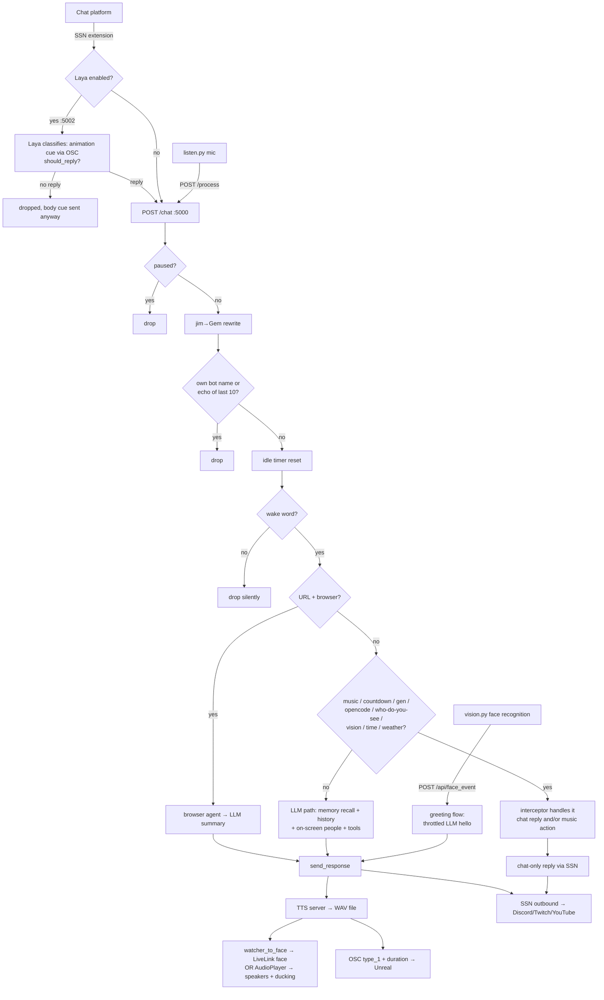

# Message Pipeline — What Happens to a Chat Message, in What Order

**Audience:** AI coding assistants + maintainer. **Answers:** "a message arrived — who sees it,
what guards run, which interceptor fires, what the LLM gets, and what comes out?"

Last verified: 2026-10-12. All `file:line` refs are as of this date.

The entire pipeline lives in one function: `handle_incoming_message()` (main.py:1100-1564).
Everything below walks through it in exact source order. Trigger phrase patterns are cataloged
in [COMMANDS.md](COMMANDS.md); process boundaries in [ARCHITECTURE.md](ARCHITECTURE.md).

## 1. Intake paths (how messages get in)

All paths converge on the same function (or inject into the same response path):

| Path | Entry point | Caller | Notes |
|---|---|---|---|
| **Chat (primary)** | `POST /chat` (main.py:2718) | SSN browser extension via HTTP "post" feature, or Laya pre-filter (`:5002`) forwarding approved messages | **Fire-and-forget**: `asyncio.create_task` + instant 200. Payload: `{"chatname", "chatmessage"}`. Laya also classifies animations and gates spam before this point. |
| **Voice** | `POST /process` (main.py:2736) | `clients/listen.py` (Whisper STT, own process) | Injected as speaker `config.VOICE_SPEAKER_NAME` (default "JayGee"). This one **awaits** the full handler. |
| **Voice activity** | `POST /api/voice_activity` (main.py:2728) | `listen.py`, the moment VAD detects speech | Only resets the idle timer — not a message. |
| **Twitch events** | `handle_twitch_event()` (main.py:197) | twitchio EventSub WebSocket (sub/follow/raid/cheer) | Skips the guard/interceptor chain; goes straight to canned thank-you + `send_response()` + optional sub animation with ducking. |
| **Face events** | `POST /api/face_event` (main.py:2709) → `handle_face_event()` (main.py:254) | vision service face recognition (vision.py, YuNet+SFace) | A recognized/unknown person **appearing on the stream camera**: memory event + throttled in-character greeting (skips guards — vision pushes only real appearances; throttled per person `VISION_FACE_GREET_COOLDOWN_S`, plus a global 20s gap and a "not while TTS is playing" check because of the shared TTS WAV). |

> The SSN **WebSocket listener is deliberately disabled** (main.py:2762-2766) — chat arrives via
> HTTP POST. Re-enabling it would double-process every message. The local `ssn_relay.py`
> (:3000) exists so the SSN browser extension doesn't need the cloud relay.

## 2. The ordered walkthrough

### Stage A — Guards (main.py:1100-1144)

In order, each one can silently drop the message:

1. **Pause gate** (main.py:1103): `_paused` flag (toggled by GUI `POST /api/pause`/`/api/resume`)
   → drop everything.
2. **"jim" → "Gem" substitution** (main.py:1112): regex `\bjim\b` case-insensitive, applied to
   the whole message. "jim" is an alternate wake name, not a bug.
3. **Known-speaker tracking** (main.py:1117-1119): first time a `chatname` appears it's saved to
   `known_speakers.json` (used later for nickname resolution in memory recall).
4. **Self blocklist** (main.py:1122-1124): speakers `gem`, `gem_chadee`, `gem-chadee` ignored —
   prevents the bot reacting to its own outbound chat messages.
5. **Echo guard** (main.py:1127-1131): if the message equals any of the last 10 AI responses
   (`_last_ai_responses` deque, main.py:405) → drop. Platforms echo posted messages back.
6. **Idle activity ping** (main.py:1134): any real message resets the idle-monologue timer.
7. **Wake-word gate** (main.py:1137-1144): message must contain one of `config.WAKE_WORDS`
   (default `["gem", "hey gem", "ok gem"]`) **anywhere** (substring, not prefix). No wake word →
   silently dropped. This is the #1 reason "Gem didn't respond".

### Stage B — Interceptor chain (main.py:1146-1470)

First match wins — each block handles the message and **returns**; the LLM never sees it.
Extractors strip the wake-word prefix themselves before parsing (e.g. `extract_song_command`
main.py:659). Exact trigger phrases: see [COMMANDS.md](COMMANDS.md).

| # | Interceptor | Guard | Handler | What it does |
|---|---|---|---|---|
| 1 | **URL in message** (main.py:1146) | `BROWSER_ENABLED` + URL regex | `browser.run_task` (main.py:1168) | Routes straight to browser agent, LLM summarizes result in-character (main.py:1169) |
| 2 | **"sing X"** — karaoke (main.py:1182) | always | `extract_sing_command` (main.py:704) | Library lookup → dual-track play; if missing → download fallback |
| 3 | **playlist start** (main.py:1199) | always | `is_playlist_command` (main.py:823) | Plays all MP3s in playlist folder |
| 4 | **playlist stop** (main.py:1210) | always | `is_stop_playlist_command` (main.py:839) | Stops playlist |
| 5 | **"play latest song you made"** (main.py:1219) | always | `is_play_latest_command` (main.py:896) | Plays newest AI-generated song (must run before generic song cmd — comment at main.py:1218) |
| 6 | **generic song request** (main.py:1231) | always | `extract_song_command` (main.py:652) | Checks generated songs first → Twitch DJ check → local file → yt-dlp download + auto-play. Dedication parsing (main.py:685) |
| 7 | **stop music** (main.py:1279) | always | `is_stop_music_command` (main.py:779) | Stops request player |
| 8 | **countdown** (main.py:1303) | `COUNTDOWN_MAX` cap | `extract_countdown_command` (main.py:852) | Numbers generated in code (LLM can't count), spelled as words, TTS'd in chunks (see timing below) |
| 9 | **"make a song ..."** (main.py:1328) | `MUSIC_GEN_ENABLED` | `extract_make_song_command` (main.py:868) | ComfyUI+YuE2 generation; busy-guard; completion callback announces via LLM (main.py:109-121) |
| 10 | **resume background music** (main.py:1346) | always | `is_resume_background_command` (main.py:792) | Restarts background song |
| 11 | **list downloaded songs** (main.py:1356) | always | `is_list_songs_command` (main.py:806) | Replies with library listing |
| 12 | **OpenCode "oc ..."** (main.py:1369) | `OPENCODE_ENABLED` | `extract_opencode_command` (main.py:733) | Runs coding task, posts formatted output |
| 13 | **"who do you see"** (main.py:1381) | `VISION_FACE_RECOGNITION_ENABLED` | `is_who_do_you_see_command` (main.py:765) | Answers from face recognition: visible names + camera frame → multimodal LLM. Runs BEFORE the generic vision trigger (it contains the word "see") |
| 14 | **vision trigger word** (main.py:1408) | `VISION_ENABLED` | `is_vision_command` (main.py:756) | Fetches frame from vision service → multimodal `llm.chat_with_image` |
| 15 | **time query** (main.py:1426) | always | `is_time_command` (main.py:1051) | Real time from hardcoded city→tz map (main.py:976), default Pattaya; LLM narrates it in-character (main.py:1434) |
| 16 | **weather query** (main.py:1448) | always | `is_weather_command` (main.py:1074) | Open-Meteo data; LLM narrates in-character, forbidden to invent weather |

Interceptors that reply via **chat only** (`ssn.send_message`, no TTS): playlist start/stop,
song request/download acknowledgements, stop music, make-a-song ack, resume background, list
songs, OpenCode. Interceptors that reply via **`send_response()`** (TTS + chat): URL browse,
sing (plays music instead), who-do-you-see, vision, time, weather.

### Stage C — Default LLM path (main.py:1473-1564)

Only messages that survived every interceptor get here:

1. **Memory store**: `cognee.remember(speaker, message)` (main.py:1474)
2. **Chat history**: rolling 20-message deque (main.py:414, 1477)
3. **Emote translation** (main.py:1480): `translate_emotes` (main.py:937) appends
   `[emotes: kekw=laughing]` style glosses from `config.EMOTE_MEANINGS`
4. **Memory recall** (main.py:1483): `get_memory_context()` (main.py:1570-1628) —
   3-second overall timeout, 3-tier fallback queries per speaker
   ("what do I remember about X" → "conversations with X" → "X"), plus entity recall for
   capitalized words and mentioned known speakers (nickname resolution main.py:955)
5. **System prompt assembly** (main.py:1486-1506): `SYSTEM_PROMPT` + **current date/time
   hardcoded to `Asia/Bangkok`** (main.py:1490) + avatar pose state (if
   `AVATAR_ACTION_TAG_ENABLED`) + memory context + chat history + **who is currently visible
   on the stream camera** (face recognition, cached 5s fetch — main.py:1507-1510)
6. **Tool call** (main.py:1512-1525): `llm.chat_with_tools` with up to two tools:
   - `trigger_animation` (main.py:2399-2428) — enum of `OSC_ACTIONS` values when defined,
     free string otherwise; fuzzy-matched by `resolve_action_value` (main.py:2498);
     applied via `apply_action_tag` → OSC to Unreal, pose persisted (main.py:2527)
   - `browse_web` (main.py:2446-2471) — browser agent task, blocked-terms filter
     (main.py:2474), result fed back to the LLM for an in-character summary (main.py:1536-1544)
7. **Fallback**: tool call with no text → "Got it!" (main.py:1547)
8. **Post-response bookkeeping** (main.py:1551-1560): remember + history + echo-track
9. **Broadcast**: `send_response()` (main.py:1563)

## 3. Response broadcast — `send_response()` (main.py:169-180)

```
response text
  ├─ TTS_ENABLED → tts.speak() → TTS server writes tts_output/server_output.wav
  │     (single overwritten file — consumers race-watch it, see timing below)
  └─ SEND_RESPONSES_TO_CHAT → ssn.send_message() → Discord/Twitch/YouTube
        → OSC "type_1" to Unreal (Gem is talking)
        → OSC float: WAV duration in seconds (main.py:234-244)
```

> main.py does NOT play the audio and does NOT drive the talk animation when Neurosync is used —
> `watcher_to_face` (separate process) watches the WAV file and owns playback/lip-sync timing
> (comment at main.py:170-172). The AudioPlayer path (main.py:383) is the alternative when
> Neurosync is off; it fires the duck callbacks (main.py:389-403).

## 4. Timing interactions (the part that's easy to break)

**A. TTS WAV single-file protocol.** One file, `TTS_OUTPUT_PATH`
(`tts_output/server_output.wav`), is overwritten per utterance. Consumers detect
size-stability then play. Consequences:
- Countdowns **must** chunk: `COUNTDOWN_TTS_CHUNK` numbers per call, `COUNTDOWN_CHUNK_DELAY_S`
  wait between calls (main.py:1313-1320), otherwise later chunks overwrite earlier audio.
- Numbers are spelled as English words (`_number_to_words`, main.py:912) because StyleTTS2
  returns 500 on bare digits.
- Face-event greetings are globally gap-limited (20s) and skipped while `audio_player`
  reports playing (main.py:283-287) so they never collide with chat responses or each other.
- Optional network-share copy (`TTS_COPY_TO`) sends the WAV + `current_pose.txt` to a second
  computer running watcher_to_face (main.py:2540-2547) — this is a two-machine rig.

**B. Music ducking.** When AudioPlayer (not Neurosync) plays TTS:
`duck_callback` → `music.duck_music(duck_amount, attack_ms, release_ms)` before playback,
`unduck_callback` after (wired at main.py:402-403, config `AUDIO_DUCK_*`). One-shot Unreal
animations with audio (Twitch sub dance) duck via `trigger_animation_with_duck`
(main.py:183-194) with a timed unduck task. GUI can duck manually: `POST /api/music/duck`
(main.py:2685).

**C. Pose management.** `apply_action_tag` sets `current_pose`, sends OSC, and persists to
`current_pose.txt` (local + network share, main.py:2527-2547). `resume_current_pose()`
(main.py:146-166) re-sends the pose OSC so the avatar keeps dancing after speaking instead of
dropping to idle. Base pose `sitting` → send stop/idle instead.

**D. Idle monologues.** `IdleManager.monitor_loop()` (clients/idle_manager.py:134, started at
main.py:2765) fires when chat is quiet for `IDLE_INACTIVITY_LIMIT` (120s) and cooldown elapsed:
picks topic → OSC state change → LLM monologue with memory context (main.py:349-369) →
`send_response()`. Guarded by `idle.is_speaking_check` (no stacking while TTS plays,
main.py:386). Any chat message (main.py:1134) or mic activity (`/api/voice_activity`,
main.py:2732) resets the timer and interrupts a playing monologue (main.py:375-379).

**E. Face recognition cadence.** vision.py's `FaceRecognizer` scan thread runs every
`VISION_FACE_SCAN_INTERVAL_S` (5s); a person counts as visible for a 10s grace window after
their last detection; an "appeared" event only fires when someone has been off-screen
> `VISION_FACE_ABSENCE_RESET_S` (120s). main.py's greeting throttle then limits per person
(`VISION_FACE_GREET_COOLDOWN_S`) and globally (20s), skipping while TTS plays.

## 5. Pipeline flowchart



## 6. Message-flow quick reference (in-memory state)

| State | Where | Purpose |
|---|---|---|
| `_paused` | main.py:408 | Global mute flag |
| `_recent_chat` | main.py:414 | Rolling 20-message LLM context |
| `_last_ai_responses` | main.py:405 | Last 10 responses (echo guard) |
| `_known_speakers` | main.py:429 + known_speakers.json | Nickname resolution + entity recall |
| `current_pose` | main.py:411 + current_pose.txt | Avatar pose across processes/machines |
| `_face_greet_last` / `_faces_context_cache` | main.py:222-229 | Face greeting throttles + 5s on-screen cache |